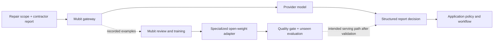

<div align="center">

# 🛠️ FIXI
### Repair coordination that learns from experience


**From “the contractor sent a message” to “the repair actually got finished.”**

</div>

> **The hackathon thesis:** use a capable model to coordinate complex repairs, then use Mubit to teach a smaller model the recurring decisions inside that workflow. Keep every operational action governed by explicit application rules.

**A repair agent that moves cases forward today—and uses Mubit to turn repeated decisions into a specialized open-weight model for tomorrow.**

A tenant reports a leaking roof. A contractor visits and discovers that scaffolding is required. Someone must arrange the scaffolding, wait for approval and handover, rebook the roofer, verify the repair, arrange removal, and confirm the outcome with the tenant.

Fixi coordinates that chain. Every report becomes evidence. Every decision becomes a visible action. **Mubit is the learning layer that gives those repeated decisions a path beyond repeatedly calling a large model.**

[Demo walkthrough](RepairFlow/docs/DEMO_WALKTHROUGH.md) · [Run locally](RepairFlow/SETUP.md) · [Application architecture](RepairFlow/README.md) · [Training evidence](RepairFlow/docs/ADAPTER_RECOVERY_PLAN.md)

## ⚡ The project in 30 seconds

| The problem | What we built | Why Mubit matters |
|---|---|---|
| Repairs stall between messages, visits, approvals, and follow-up work. | An agent that maintains case state and proposes the next actionable step. | Repeated report decisions become material for specialist-model training. |
| A short report can change the entire repair plan. | A scope-aware, seven-outcome classification task. | A stable input/output contract gives adaptation a measurable target. |
| A convincing model response can still be an invalid action. | Policy checks, approvals, dependencies, and visible execution results. | Model optimization stays separate from the rules that protect the workflow. |

**Observed learning signal:** the focused adapter scored **10/12**, compared with **5/12** for base + prompt in Mubit's internal evaluation. **Still pending:** readiness, verified serving, and an independent benchmark. Full context and evidence appear below.

## 🎯 The problem: automate the follow-through

Repair management is full of small decisions with real consequences: is the work finished, is access missing, did the contractor fail to attend, or must another job happen first?

Fixi keeps the case moving through intake, clarification, contractor selection, appointments, prerequisites, approvals, reports, and tenant confirmation. The agent proposes a structured next action; application rules check whether that action is allowed before it changes the case.

The demo makes this process inspectable:

- **See the decision:** the proposed action, supporting evidence, and execution result are visible.
- **Supply the next event:** enter a simulated tenant reply or contractor report directly in the case.
- **Watch the workflow continue:** missing information, failed visits, additional work, and completion each lead to different next steps.
- **Keep control:** hazards trigger escalation, commitments can require approval, and unresolved required work blocks closure.

No real tenant or contractor is contacted. Physical visits and bookings are simulated; configured model requests are real.

## 🧠 Why Mubit is the center of the idea

Without Mubit, the agent can coordinate repairs, but each recurring language decision still depends on the configured provider model. With Mubit, those calls also supply examples for a specialized adapter: a way to turn repeated work into a reusable model capability.

Our strongest learning target is deliberately narrow and useful: **interpret a contractor's report against the work they were supposed to perform.** The frozen task returns one of seven outcomes:

| Outcome | Example meaning |
|---|---|
| `COMPLETED` | The assigned work is explicitly finished. |
| `NO_ACCESS` | The contractor could not enter the property. |
| `NO_SHOW` | The appointment was missed. |
| `FAILED` | The attempted repair did not resolve the problem. |
| `SCAFFOLD_REQUIRED` | Scaffolding is a prerequisite for the work. |
| `CLARIFY` | The report does not establish a clear outcome. |
| `ESCALATE` | The report contains a hazard requiring escalation. |

This is a useful boundary for adaptation: the input changes across repairs, while the instructions and output contract remain stable. A smaller model can be evaluated on this specific decision without being asked to replace the entire coordinator, policy engine, or database.



**The intended payoff:** keep the larger model for broader reasoning, and use a validated smaller adapter for the repeated task it has learned. Lower cost and faster responses are goals to measure—not savings we claim before verifying actual adapter serving.

## ✨ What makes the approach distinctive

**A real workflow creates the learning opportunity.** Classification is attached to an operational problem: a report about scaffolding must be interpreted against the assigned scope, and cannot automatically mean that the roof repair is complete.

**One agent, a focused optimization target.** We initially explored broad next-action coordination, then narrowed adaptation to report interpretation. Recorded coordinator adapters scored only **7.7%** and **13.3%**; the focused classifier reached **83.3%** in a different task evaluation. These are not comparable controlled benchmarks, but they explain the engineering choice to specialize. [Experiment history →](RepairFlow/docs/ADAPTER_RECOVERY_PLAN.md)

**An auditable learning loop.** Requests, accepted examples, training, evaluation, and actual serving are distinct milestones. We track them separately, rather than calling successful API traffic “a trained model.”

**Safety survives model changes.** The application retains authority over appointments, approvals, prerequisite completion, and case closure. An adapter must earn its place through evaluation; a smaller model does not receive broader permissions.

## 📊 Evidence, not just a pitch

The figures below are recorded experiment results from **24 October 2026**, not a live status feed. Provider agreement and adapter evaluation measure different things.

| Experiment | Recorded result | What it establishes |
|---|---|---|
| Focused small-model adapter, Mubit internal evaluation | **83.3% · 10/12** versus **41.7% · 5/12** for base + prompt | A **41.7 percentage-point improvement** on Mubit's reported evaluation, with a small sample. |
| New-account collection: 200 distinct synthetic scenarios | **195/200 · 97.5%** expected-label agreement; **0 request errors** | Strong provider responses for collection; not trained-adapter accuracy. |
| Hazard cases within that 200-request collection | **28/28** expected escalation labels | Correct escalation on those synthetic provider cases; not a universal safety guarantee. |
| Additional 300-request collection | **293/300 · 97.7%** expected-label agreement; **0 request errors** | Broader wording coverage: 60 scenario families with five variants each. |
| Independent report evaluation corpus | **28 cases reserved and not submitted** | A separate evaluation remains to be run once adapter serving is verified. |

The adapter is **Qwen3-4B-Instruct-2507**, version 1. At the last verified console check, it had **not passed readiness**: its score was below the **85% target**, and only **12 of the required 20 judged cases** were available. It was not deployed or serving application requests. The original and new-account collections are separate experiments; they must not be combined into a claim that one adapter trained on every call.

The report-classification integration in the application is currently **default-off shadow mode**. It does not replace the coordinator's authoritative decisions. The remaining milestone is to pass Mubit's gates, verify adapter/version and fallback provenance, then measure independent accuracy, latency, and cost.

Evidence: [adapter history and recovery log](RepairFlow/docs/ADAPTER_RECOVERY_PLAN.md), [200-scenario collection](RepairFlow/docs/MUBIT_FRESH_COLLECTION.md), [300-request collection](RepairFlow/docs/MUBIT_BULK_COLLECTION.md).

## 💸 The savings opportunity

**Measured production savings: not established yet.** The adapter is not confirmed serving, and we have not measured its billed cost or latency. The value proposition is to avoid paying the provider-model cost for every repeated classification once a reliable specialist is available.

Here is an **illustrative sensitivity model—not Mubit pricing or a forecast**. Let `r` be adapter cost divided by provider cost for the same task, and `f` the fraction of classifier calls routed successfully to the adapter. Ignoring training costs, retries, and overhead:

```text
Classifier inference savings = f × (1 − r)
```

| Assumed successful adapter share | Assumed adapter cost relative to provider | Illustrative classifier savings |
|---:|---:|---:|
| 50% | 50% | 25% |
| 80% | 25% | 60% |
| 90% | 10% | 81% |

For example, **60% savings on classification does not mean 60% savings on the whole app**. If classification accounts for 30% of baseline model spend, that scenario would reduce total model spend by 18%, before training and operational overhead. These percentages are assumptions to show the opportunity, not observed results. Classification accuracy also does not automatically equal successful routing share.

The final benchmark must record the actual adapter/version, fallback rate, correctness, tokens, latency, and billed costs. The meaningful metric is **cost per correct decision**, not simply the cheapest response.

## 🎬 A demo with decisions you can inspect

**Start with a roof leak.** Submit the issue, supply the missing information, and let the coordinator propose an appointment. Enter a contractor report saying the roof cannot be repaired without scaffolding. The workflow creates the prerequisite instead of treating the visit as a completed repair.

Continue with a scaffolding report, an approval, the roof repair report, and tenant confirmation. The original repair stays unresolved until its required work and confirmation conditions are satisfied.

Representative browser journeys have covered a normal repair, missing information, a gas-hazard escalation, and the roof/scaffolding dependency chain. Failures found during those runs led to checks against invented safety answers, invalid appointment slots, unsupported contractor choices, and premature case closure. The UI distinguishes a model proposal from an action that actually executed.

See [browser verification and its limitations](RepairFlow/docs/DEMO_VERIFICATION.md) and the [decision reliability audit](RepairFlow/docs/DECISION_RELIABILITY_AUDIT.md). These reports are dated snapshots, not a claim that every possible real-world case has been tested.

## 🔎 Reviewer evidence map

Use this map to inspect implementation and recorded results. No paid training run is needed to review the project.

| Claim to inspect | Source |
|---|---|
| Mubit gateway integration and tracing | [Provider integration](RepairFlow/backend/app/agents/mubit.py) · [Tracing](RepairFlow/backend/app/agents/tracing.py) |
| Stable report-classification contract | [Task definition](RepairFlow/backend/app/agents/report_task.py) · [Routing and shadow integration](RepairFlow/backend/app/agents/report_routing.py) |
| Application checks before action execution | [Decision validation](RepairFlow/backend/app/agents/decision_validation.py) · [Executor](RepairFlow/backend/app/orchestration/executor.py) |
| Synthetic scenario construction | [Fresh training corpus](RepairFlow/backend/app/report_training_fresh.py) · [Corpus tests](RepairFlow/backend/tests/test_report_training_fresh.py) |
| Adapter score, readiness gates, and limitations | [Dated recovery log](RepairFlow/docs/ADAPTER_RECOVERY_PLAN.md) |
| Completed browser journeys and discovered defects | [Demo verification](RepairFlow/docs/DEMO_VERIFICATION.md) · [Decision audit](RepairFlow/docs/DECISION_RELIABILITY_AUDIT.md) |
| Budget discipline and account separation | [Fresh collection record](RepairFlow/docs/MUBIT_FRESH_COLLECTION.md) |

The evidence links include implementation, tests, and dated experiment notes. Private runtime logs and credentials are intentionally excluded from Git; the notes are not a substitute for a fresh, independently reproduced adapter benchmark.

## 🚀 Run the project

Follow **[SETUP.md](RepairFlow/SETUP.md)** for dependencies, environment configuration, database initialization, and startup. For Mubit configuration, see the [integration guide](RepairFlow/docs/MUBIT_INTEGRATION.md); its earlier implementation notes should be read alongside the newer [adapter recovery log](RepairFlow/docs/ADAPTER_RECOVERY_PLAN.md).

The application uses a **React/Vite frontend**, **FastAPI backend**, **Pydantic AI coordinator**, and **SQLite case/event storage**. Mubit provides the gateway and adapter-learning workflow; the focused collection uses Claude Haiku 4.5 as its provider model.

```text
RepairFlow/
  backend/          API, coordinator, policy checks, training tools and tests
  frontend-fixi/    Case dashboard, agent activity and demo response forms
  docs/             Architecture, walkthroughs and experiment evidence
  prompts/          Agent prompt resources
docs/               Initial learning-lab guide
index.html          Initial learning-lab interface
server.mjs          Initial learning-lab server
```

This is one Git repository. `RepairFlow/` is an ordinary project directory, with its path preserved for local configuration. The initial support-message experiment remains available through `npm start`; see its [separate guide](docs/LEARNING_LAB.md).

Credentials, local databases, dependencies, builds, and runtime collection logs are excluded from Git. Configure your own environment and initialize the database after cloning. Live model calls consume credits; collection scripts are experiments, not a requirement for starting the demo.
