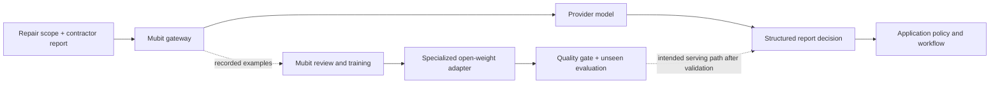

<div align="center">

# 🛠️ FIXI
### Repair coordination that learns from experience


**From “the contractor sent a message” to “the repair actually got finished.”**

</div>

> **The hackathon thesis:** use a capable model to coordinate complex repairs, then use Mubit to teach a smaller model the recurring decisions inside that workflow. Keep every operational action governed by explicit application rules.

**FIXI is a B2B maintenance coordinator for property-management companies and housing providers: automate the coordination cycle, bring people in for judgment and approvals, and use Mubit to specialize the decisions that repeat.**

The buyer is the head of property management or repairs operations; the daily user is the property manager responsible for keeping cases moving. Our long-term opportunity is large housing portfolios. The initial discovery hypothesis is a 300–3,000-home agency; supporting a 100,000-home organisation is an ambition, not a demonstrated deployment capacity. [Buyer hypothesis and product scope →](RepairFlow/docs/01_PRODUCT_VISION.md)

A tenant reports a leaking roof. A contractor visits and discovers that scaffolding is required. Someone must arrange the scaffolding, wait for approval and handover, rebook the roofer, verify the repair, arrange removal, and confirm the outcome with the tenant.

Fixi coordinates that chain. Every report becomes evidence. Every decision becomes a visible action. **Mubit is the learning layer that gives those repeated decisions a path beyond repeatedly calling a large model.**

[2-minute demo plan](docs/DEMO_SUBMISSION_PLAN.md) · [Interactive walkthrough](RepairFlow/docs/DEMO_WALKTHROUGH.md) · [Run locally](RepairFlow/SETUP.md) · [Application architecture](RepairFlow/README.md) · [Training evidence](RepairFlow/docs/ADAPTER_RECOVERY_PLAN.md)

## ⚡ The project in 30 seconds

| The problem | What we built | Why Mubit matters |
|---|---|---|
| Repairs stall between messages, visits, approvals, and follow-up work. | An agent that maintains case state and proposes the next actionable step. | Repeated report decisions become material for specialist-model training. |
| A short report can change the entire repair plan. | A scope-aware, seven-outcome classification task. | A stable input/output contract gives adaptation a measurable target. |
| A convincing model response can still be an invalid action. | Policy checks, approvals, dependencies, and visible execution results. | Model optimization stays separate from the rules that protect the workflow. |

**Latest observed learning signal:** the second-account focused adapter scored **91.7% (11/12)** in Mubit's internal evaluation, above its **85% quality target**. It remains in Testing because live readiness requires at least **20 judged cases**. **Still pending:** readiness, verified serving, and an independent benchmark. Full context and evidence appear below.

## 🎯 The problem: automate the follow-through

### A large operational problem, with published evidence

| Published evidence | Why it matters for FIXI |
|---|---|
| **£10 billion** spent on repairs and maintenance in 2024/25 by England's private registered social-housing providers, **13% more** than the previous year. [Regulator of Social Housing, 2025 Global Accounts, Figure 3](https://www.gov.uk/government/publications/2025-global-accounts-of-private-registered-providers/2025-global-accounts-of-private-registered-providers) | Repairs are a substantial, recurring operating responsibility with pressure to use resources effectively. This includes physical maintenance and major works; it is not a software-market valuation or an estimate of avoidable administration. |
| **Over 18.7 million repairs raised**, with **almost 1.2 million still in progress at year-end**, across reporting English social landlords in 2024/25. [RSH Tenant Satisfaction Measures, §5.6](https://www.gov.uk/government/statistics/tenant-satisfaction-measures-202425/tenant-satisfaction-measures-202425-headline-report) | Millions of cases need an owner, current evidence, and a next step. In-progress repairs are not necessarily overdue, and these figures do not attribute every delay to coordination. |
| Clarion Response serves **over 100,000 homes** and completes an average of **1,200 repairs every working day**. [Clarion's service description](https://www.clarionhg.com/about-us/what-we-do/clarion-response-repairs-service) | The enterprise scale is real: one organisation can face substantial daily repair volume. Clarion is an example of market scale, not a FIXI customer or partner. |

The Housing Ombudsman's [Repairing Trust report (2025)](https://www.housing-ombudsman.org.uk/reports/spotlight-reports/repairing-trust/) identifies poor communication, information failures, and contractor relationships as recurring repair-service concerns. **That is FIXI's opportunity: connect the decisions and handoffs between the people doing the work.** These sources concern social housing; they support the scale and nature of the problem, not proven demand or ROI in our initial private-lettings segment.

### What changes for the property manager

Repair management is full of small decisions with real consequences: is the work finished, is access missing, did the contractor fail to attend, or must another job happen first?

Fixi keeps the case moving through intake, clarification, contractor selection, appointments, prerequisites, approvals, reports, and tenant confirmation. The agent proposes a structured next action; application rules check whether that action is allowed before it changes the case.

| Coordination burden | FIXI's demonstrated workflow | Intended customer benefit |
|---|---|---|
| Read reports and reconstruct what happened. | Preserve evidence and interpret each report against the assigned work. | Less manual history reconstruction; a clear current case state. |
| Discover and chase follow-on jobs. | Create explicit prerequisites and block dependent work until they are satisfied. | Fewer unowned handoffs and less repeated chasing. |
| Track approvals and decide what can happen next. | Check proposed actions against policy, approval requirements, and dependencies. | Managers focus on decisions requiring their authority. |
| Decide whether a visit actually resolved the issue. | Keep the original issue open until required work and tenant-confirmation conditions are met. | Avoid confusing attendance with resolution. |

**The product ambition is end-to-end coordination automation, with human involvement concentrated on approvals, hazards, and ambiguous exceptions.** The prototype demonstrates the state, reasoning, and control loop using simulated external interactions. Production outreach and booking integrations remain necessary before that ambition can become an unattended real-world service.

The demo makes this process inspectable:

- **See the decision:** the proposed action, supporting evidence, and execution result are visible.
- **Supply the next event:** enter a simulated tenant reply or contractor report directly in the case.
- **Watch the workflow continue:** missing information, failed visits, additional work, and completion each lead to different next steps.
- **Keep control:** hazards trigger escalation, commitments can require approval, and unresolved required work blocks closure.

No real tenant or contractor is contacted. Physical visits and bookings are simulated; configured model requests are real.

## 🧠 Why Mubit is the center of the idea

Without Mubit, the agent can coordinate repairs, but each recurring language decision still depends on the configured provider model. With Mubit, those calls also supply examples for a specialized adapter: a way to turn repeated work into a reusable model capability.

**Why this workload fits Mubit:** repair cases vary, but the same bounded decisions recur across a portfolio. Each report already has its work scope, evidence, and a structured outcome. That gives the learning workflow a concrete task, reusable examples, and a measurable acceptance criterion. Mubit supplies the gateway and specialist-training lifecycle; FIXI supplies the operational context and keeps authority over actions.

The division of labour is deliberate: a capable coordinator reasons across the case, a smaller specialist targets repeated report interpretation, and deterministic application checks govern execution. This makes specialization useful without asking a four-billion-parameter model to own the entire repair operation. **The trained specialist's 91.7% internal result is evidence for this focused learning target—not a claim of 91.7% end-to-end repair automation.**

Our strongest learning target is deliberately narrow and useful: **interpret a contractor's report against the work they were supposed to perform.** The frozen task returns one of seven outcomes:

| Outcome | Example meaning |
|---|---|
| `COMPLETED` | The assigned work is explicitly finished. |
| `NO_ACCESS` | The contractor could not enter the property. |
| `NO_SHOW` | The appointment was missed. |
| `FAILED` | The attempted repair did not resolve the problem. |
| `SCAFFOLD_REQUIRED` | Scaffolding is a prerequisite for the work. |
| `CLARIFY` | The report does not establish a clear outcome. |
| `ESCALATE` | The report contains a hazard requiring escalation. |

This is a useful boundary for adaptation: the input changes across repairs, while the instructions and output contract remain stable. A smaller model can be evaluated on this specific decision without being asked to replace the entire coordinator, policy engine, or database.



**The intended payoff:** keep the larger model for broader reasoning, and use a validated smaller adapter for the repeated task it has learned. Lower cost and faster responses are goals to measure—not savings we claim before verifying actual adapter serving.

## ✨ What makes the approach distinctive

**A real workflow creates the learning opportunity.** Classification is attached to an operational problem: a report about scaffolding must be interpreted against the assigned scope, and cannot automatically mean that the roof repair is complete.

**One agent, a focused optimization target.** We initially explored broad next-action coordination, then narrowed adaptation to report interpretation. Recorded coordinator adapters scored only **7.7%** and **13.3%**; the focused classifier reached **83.3% in the original account** and **91.7% in the second account**, on separate internal evaluations. These are not comparable controlled benchmarks, but they explain the engineering choice to specialize. [Experiment history →](RepairFlow/docs/ADAPTER_RECOVERY_PLAN.md)

**An auditable learning loop.** Requests, accepted examples, training, evaluation, and actual serving are distinct milestones. We track them separately, rather than calling successful API traffic “a trained model.”

**Safety survives model changes.** The application retains authority over appointments, approvals, prerequisite completion, and case closure. An adapter must earn its place through evaluation; a smaller model does not receive broader permissions.

## 📊 Evidence, not just a pitch

The figures below are recorded experiment results from **24–25 October 2026**, not a live status feed. Provider agreement and adapter evaluation measure different things.

| Experiment | Recorded result | What it establishes |
|---|---|---|
| Original-account adapter, Mubit internal evaluation | **83.3% · 10/12** versus **41.7% · 5/12** for base + prompt | A **41.7 percentage-point improvement** on Mubit's reported evaluation, with a small sample. |
| Second-account adapter, Mubit internal evaluation | **91.7% · 11/12**, target **85%**; base + prompt reported **0/12** | Above-target internal quality; still below the 20-judged-case readiness requirement. |
| New-account collection: 200 distinct synthetic scenarios | **195/200 · 97.5%** expected-label agreement; **0 request errors** | Strong provider responses for collection; not trained-adapter accuracy. |
| Hazard cases within that 200-request collection | **28/28** expected escalation labels | Correct escalation on those synthetic provider cases; not a universal safety guarantee. |
| Additional 300-request collection | **293/300 · 97.7%** expected-label agreement; **0 request errors** | Broader wording coverage: 60 scenario families with five variants each. |
| Independent report evaluation corpus | **28 cases reserved and not submitted** | A separate evaluation remains to be run once adapter serving is verified. |

Both focused adapters use **Qwen3-4B-Instruct-2507**, version 1. At the latest successful second-account inspection (25 October, approximately 01:38 BST), Terdessa showed **200 recorded requests, 32 kept examples, 1 rejected example, and 167 awaiting review**. The second-account adapter exceeded its quality target but remained **Testing**: **12 judged cases**, **20 required**, **no route**, and **no application requests served by the adapter**.

These are separate account experiments, not successive versions tested on a common benchmark. Do not interpret the score difference as a controlled improvement from 83.3% to 91.7%. The second account's evaluation compares with recorded provider answers; an independent live provider comparison and schema-validity measurement were not reported. Twelve cases provide limited evidence of generalization.

Later console sessions expired, so these values are historical observations, not a claim about the current live dashboard. The full backlog need not be reviewed before readiness, and reviewing it is not a verified guarantee of readiness.

The report-classification integration in the application is currently **default-off shadow mode**. It does not replace the coordinator's authoritative decisions. The remaining milestone is to pass Mubit's gates, verify adapter/version and fallback provenance, then measure independent accuracy, latency, and cost.

Evidence: [adapter history and recovery log](RepairFlow/docs/ADAPTER_RECOVERY_PLAN.md), [200-scenario collection](RepairFlow/docs/MUBIT_FRESH_COLLECTION.md), [300-request collection](RepairFlow/docs/MUBIT_BULK_COLLECTION.md).

## 💸 The savings opportunity

### Primary customer value: staff coordination capacity

FIXI targets the active work spread across a repair's lifecycle: reading, scheduling, chasing, reconciling updates, managing prerequisites, and checking closure. The opportunity is to remove repeated coordination work across the cycle, not just shorten one message. Physical repairs still require tradespeople; approval and exception handling still require human responsibility.

The pilot should measure **human coordination minutes per resolved case**, the share of cases requiring intervention, follow-up contacts, dependency recovery time, and reopened cases. Calculate time freed as:

```text
Annual staff hours freed = annual repair cases
                         × (baseline active minutes − active minutes with FIXI) / 60
```

Measure the remaining human work across all cases, including review, exceptions, and corrections. Elapsed waiting days are not staff hours, and freed capacity is not automatically a cash saving. We have not measured customer time savings yet; the workflow demonstration establishes the mechanism to test in a pilot. [Research and pilot measurement plan →](RepairFlow/docs/02_BUSINESS_PROBLEM_RESEARCH.md)

### Additional opportunity: specialist-model economics

**Measured production savings: not established yet.** The adapter is not confirmed serving, and we have not measured its billed cost or latency. The value proposition is to avoid paying the provider-model cost for every repeated classification once a reliable specialist is available.

Here is an **illustrative sensitivity model—not Mubit pricing or a forecast**. Let `r` be adapter cost divided by provider cost for the same task, and `f` the fraction of classifier calls routed successfully to the adapter. Ignoring training costs, retries, and overhead:

```text
Classifier inference savings = f × (1 − r)
```

| Assumed successful adapter share | Assumed adapter cost relative to provider | Illustrative classifier savings |
|---:|---:|---:|
| 50% | 50% | 25% |
| 80% | 25% | 60% |
| 90% | 10% | 81% |

For example, **60% savings on classification does not mean 60% savings on the whole app**. If classification accounts for 30% of baseline model spend, that scenario would reduce total model spend by 18%, before training and operational overhead. These percentages are assumptions to show the opportunity, not observed results. Classification accuracy also does not automatically equal successful routing share.

The final benchmark must record the actual adapter/version, fallback rate, correctness, tokens, latency, and billed costs. The meaningful metric is **cost per correct decision**, not simply the cheapest response.

## 🎬 A demo with decisions you can inspect

**Start with a roof leak.** Submit the issue, supply the missing information, and let the coordinator propose an appointment. Enter a contractor report saying the roof cannot be repaired without scaffolding. The workflow creates the prerequisite instead of treating the visit as a completed repair.

Continue with a scaffolding report, an approval, the roof repair report, and tenant confirmation. The original repair stays unresolved until its required work and confirmation conditions are satisfied.

Representative browser journeys have covered a normal repair, missing information, a gas-hazard escalation, and the roof/scaffolding dependency chain. Failures found during those runs led to checks against invented safety answers, invalid appointment slots, unsupported contractor choices, and premature case closure. The UI distinguishes a model proposal from an action that actually executed.

See [browser verification and its limitations](RepairFlow/docs/DEMO_VERIFICATION.md) and the [decision reliability audit](RepairFlow/docs/DECISION_RELIABILITY_AUDIT.md). These reports are dated snapshots, not a claim that every possible real-world case has been tested.

## 🔎 Reviewer evidence map

Use this map to inspect implementation and recorded results. No paid training run is needed to review the project.

| Claim to inspect | Source |
|---|---|
| Mubit gateway integration and tracing | [Provider integration](RepairFlow/backend/app/agents/mubit.py) · [Tracing](RepairFlow/backend/app/agents/tracing.py) |
| Stable report-classification contract | [Task definition](RepairFlow/backend/app/agents/report_task.py) · [Routing and shadow integration](RepairFlow/backend/app/agents/report_routing.py) |
| Application checks before action execution | [Decision validation](RepairFlow/backend/app/agents/decision_validation.py) · [Executor](RepairFlow/backend/app/orchestration/executor.py) |
| Synthetic scenario construction | [Fresh training corpus](RepairFlow/backend/app/report_training_fresh.py) · [Corpus tests](RepairFlow/backend/tests/test_report_training_fresh.py) |
| Adapter score, readiness gates, and limitations | [Dated recovery log](RepairFlow/docs/ADAPTER_RECOVERY_PLAN.md) |
| Completed browser journeys and discovered defects | [Demo verification](RepairFlow/docs/DEMO_VERIFICATION.md) · [Decision audit](RepairFlow/docs/DECISION_RELIABILITY_AUDIT.md) |
| Budget discipline and account separation | [Fresh collection record](RepairFlow/docs/MUBIT_FRESH_COLLECTION.md) |

The evidence links include implementation, tests, and dated experiment notes. Private runtime logs and credentials are intentionally excluded from Git; the notes are not a substitute for a fresh, independently reproduced adapter benchmark.

## 🧩 Runtime architecture and responsibility boundaries

| Layer | Responsibility | What it cannot establish by itself |
|---|---|---|
| React interface | Intake, case state, approval controls, simulated responses, action history | A visible proposal is not proof of successful execution. |
| FastAPI + SQLite | Persist cases, evidence, appointments, events and action outcomes | Stored events do not prove physical repair work happened. |
| Background coordinator | Read scoped evidence and propose the next typed action | The model cannot bypass executor policy. |
| Policy and executor | Check permissions, state, evidence, dependencies and execution conditions | Guards do not guarantee every unseen scenario is handled. |
| Mubit gateway | Route configured provider requests and record learning traffic | An HTTP success does not mean an example was accepted for training. |
| Focused report task | Interpret work scope and report text using a frozen output contract | Shadow results do not control authoritative workflow decisions. |
| Mubit adapter lifecycle | Review examples, train a specialist and report evaluation | An above-target score alone does not prove serving or production savings. |

A representative event flow is: **new evidence → queued work → coordinator reads case → typed proposal → validation/approval → domain action → persisted result → refreshed UI**. If the agent needs more information, the demo response form supplies evidence for another iteration. The report classifier is a separate, bounded task within this broader design.

## 🧪 Testing and benchmark design

There are three different evidence levels:

1. **Deterministic regression tests** exercise policies, transitions, validation, structured outputs and failure recovery. They test software behavior without proving model reasoning quality.
2. **Browser journeys** demonstrate representative workflows against the app, including simulated responses and visible execution outcomes. The recorded journeys and discovered bugs are linked above.
3. **Model evaluations** score predictions. Provider agreement during collection and Mubit's internal adapter evaluation must be reported separately from our independent final benchmark.

The report corpus includes separate training, development and reserved evaluation splits. The 28 reserved cases have not been sent to the model. As documented in the recovery log, some held-out text was exposed during development inspection; a newly authored blind set after freezing the candidate would provide stronger independence. Never silently recycle failed evaluation cases into prompt tuning and still call the result unseen.

The final evaluation should capture, per case: expected label, predicted label, error status, actual serving model/version, fallback provenance, latency, token usage and available billing evidence. Report overall and per-class accuracy, a confusion matrix, unsafe false completion, escalation errors, fallback share, and cost per correct decision. Missing provenance means **unverified serving**, not an adapter success.

Useful local checks, from their respective directories:

```sh
# RepairFlow/backend — software tests; do not run collection scripts as tests
uv run pytest

# RepairFlow/frontend-fixi
npm test
npm run typecheck
npm run build
npm run test:browser
```

These commands are a verification entry point, not a claim that they were all rerun for this README update. Browser test environment requirements are documented in the frontend project. Paid collection is a separate, explicitly budgeted activity.

## 🚦 What is ready and what remains

| Capability | State at the documented checkpoint |
|---|---|
| Case coordination and simulated responses | Implemented; representative end-to-end journeys recorded. |
| Redesigned frontend | Pulled and production build passed; not every redesigned interaction was rechecked in that pull. |
| Mubit provider integration | Implemented and exercised with real synthetic requests. |
| Focused Qwen3 4B adapter | Trained; second-account internal quality above target. |
| Adapter live readiness and application serving | Pending; no active route at the last successful inspection. |
| Independent adapter/provider benchmark | Pending; reserved examples not submitted. |
| Measured cost and latency improvement | Not established. |
| Real tenant calls, physical visits and bookings | Simulated for the demo. |

The demo can show the working provider-backed workflow and the trained adapter's evidence separately. A fallback demonstration must clearly label fixture behavior or recorded footage. It must not present them as a live adapter run.

## 🚀 Run the project

Start in `RepairFlow/` when following the setup guide; the root `npm start` runs the separate learning lab, not the repair dashboard.

Follow **[SETUP.md](RepairFlow/SETUP.md)** for dependencies, environment configuration, database initialization, and startup. For Mubit configuration, see the [integration guide](RepairFlow/docs/MUBIT_INTEGRATION.md); its earlier implementation notes should be read alongside the newer [adapter recovery log](RepairFlow/docs/ADAPTER_RECOVERY_PLAN.md).

The application uses a **React/Vite frontend**, **FastAPI backend**, **Pydantic AI coordinator**, and **SQLite case/event storage**. Mubit provides the gateway and adapter-learning workflow; the focused collection uses Claude Haiku 4.5 as its provider model.

```text
RepairFlow/
  backend/          API, coordinator, policy checks, training tools and tests
  frontend-fixi/    Case dashboard, agent activity and demo response forms
  docs/             Architecture, walkthroughs and experiment evidence
  prompts/          Agent prompt resources
docs/               Initial learning-lab guide
index.html          Initial learning-lab interface
server.mjs          Initial learning-lab server
```

This is one Git repository. `RepairFlow/` is an ordinary project directory, with its path preserved for local configuration. The initial support-message experiment remains available through `npm start`; see its [separate guide](docs/LEARNING_LAB.md).

Credentials, local databases, dependencies, builds, and runtime collection logs are excluded from Git. Configure your own environment and initialize the database after cloning. Live model calls consume credits; collection scripts are experiments, not a requirement for starting the demo.


## 🏁 Submission and provenance

The supplied Night Shift rules require all live LLM calls to go through Mubit, a public team repository, two check-ins, an uploaded video of at most three minutes, and a PDF deck. The [demo submission plan](docs/DEMO_SUBMISSION_PLAN.md) turns those deliverables into a timed story and rehearsal checklist. Our video targets **1:50**, with a stricter **2:00 maximum**.

Fixi builds on the existing RepairFlow application. Event work includes Mubit integration, focused classification and collection experiments, demo response controls, decision reliability work, and the frontend redesign. The inherited application is not represented as newly written during the event. Organizer confirmation is needed on whether that foundation is acceptable under the event's code-origin rule; commit timestamps alone do not establish eligibility.

For a quick technical review, start with the evidence map, then the recovery log and runnable setup. For a presentation, start with one repair case and show the exact decision that changes its path.
