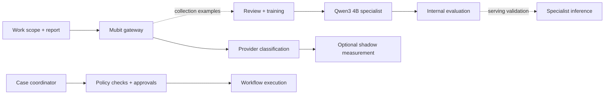

# FIXI — AI Repair Coordination That Learns

**B2B maintenance coordination for property-management companies and housing providers.**

FIXI connects tenant reports, contractors, dependencies, approvals, and follow-up in one policy-controlled workflow. Mubit provides the gateway and learning architecture for specializing recurring decisions.


**Built and demonstrated:** repair-case coordination, real Mubit learning-data collection, and a trained specialist scoring **91.7% (11/12)** in its recorded internal evaluation, above its **85% target**.

[Run FIXI](RepairFlow/SETUP.md) · [Walkthrough](RepairFlow/docs/DEMO_WALKTHROUGH.md) · [Training evidence](RepairFlow/docs/ADAPTER_RECOVERY_PLAN.md)

## The Problem

A leaking roof is rarely one job. A contractor discovers scaffolding is needed. Someone must arrange it, secure approval, confirm access, rebook the roofer, arrange removal, and verify that the tenant's problem is resolved.

Across large portfolios, these handoffs become a substantial operational workload.

| Published evidence | Scope |
|---|---|
| **£10 billion spent on repairs and maintenance; up 13% year on year** | England's private registered social-housing providers, 2024/25. Includes physical maintenance and major works. [RSH Global Accounts, Figure 3](https://www.gov.uk/government/publications/2025-global-accounts-of-private-registered-providers/2025-global-accounts-of-private-registered-providers) |
| **Over 18.7 million repairs raised; almost 1.2 million in progress at year-end** | Reporting English social landlords, 2024/25. In progress does not necessarily mean overdue. [RSH Tenant Satisfaction Measures, §5.6](https://www.gov.uk/government/statistics/tenant-satisfaction-measures-202425/tenant-satisfaction-measures-202425-headline-report) |
| **Over 100,000 homes; around 1,200 repairs each working day** | Clarion Response demonstrates enterprise scale. Clarion is a market example, not a FIXI customer. [Clarion](https://www.clarionhg.com/about-us/what-we-do/clarion-response-repairs-service) |

The Housing Ombudsman's [Repairing Trust report](https://www.housing-ombudsman.org.uk/reports/spotlight-reports/repairing-trust/) identifies communication, information management, and contractor relationships as recurring concerns. FIXI targets the coordination between those people and systems.

**Buyer:** heads of property management and repairs operations.
**Daily user:** property managers supervising cases, approvals, and exceptions.

The initial discovery hypothesis is a 300–3,000-home agency, with large portfolios as the longer-term opportunity. Social-housing evidence supports problem scale, not proven private-lettings demand, a software-market valuation, or tested 100,000-home deployment capacity. [Product vision](RepairFlow/docs/01_PRODUCT_VISION.md)

## What FIXI Does

FIXI implements the repair-coordination state, reasoning, and control loop. The coordinator tracks cases, interprets reports, and executes workflow actions after application policies permit them.

| Capability | Customer value |
|---|---|
| Persistent case state and evidence-linked reports | Understand the case without reconstructing scattered conversations. |
| Explicit work dependencies | Preserve the original repair while prerequisites are completed. |
| Policy-controlled actions and approvals | Focus human attention on commitments and exceptions requiring authority. |
| Follow-up and next-step coordination | Reduce repeated manual chasing across the cycle. |
| Required-work and tenant-confirmation checks | Distinguish attendance from resolution. |
| Inspectable agent history | See evidence, proposals, checks, and execution results. |

### Business Value and Efficiency

The goal is full-cycle coordination automation, with people handling approvals, hazards, and ambiguous exceptions. This targets reading, scheduling, chasing, reconciling updates, and checking closure—not just faster message drafting.

Customer time savings are a key pilot measurement target. Measure human coordination minutes per resolved case, intervention rate, follow-up contacts, dependency recovery time, and reopened cases.

```text
Annual staff hours freed = annual repair cases
                         × (baseline active minutes − active minutes with FIXI) / 60
```

Remaining work includes human review and corrections. Freed capacity is distinct from cash savings; waiting days are not staff hours. Specialist-model routing adds a separate cost-optimization opportunity. Financial ROI, inference cost, and latency benefits require measurement. [Research and pilot plan](RepairFlow/docs/02_BUSINESS_PROBLEM_RESEARCH.md)

## How Mubit Powers Learning

**The workflow creates the learning opportunity.** Cases vary, but bounded decisions recur. Work scope, report text, and structured classifications create a stable contract for training and evaluation.

Mubit powers configured provider routing, learning-data collection, and specialist training. FIXI supplies operational context, classification integration code, and policy-controlled execution.

The focused task: **interpret a contractor's report against the work they were assigned.**

| Outcome | Meaning |
|---|---|
| `COMPLETED` | Assigned work explicitly finished. |
| `NO_ACCESS` | Contractor could not enter. |
| `NO_SHOW` | Appointment missed. |
| `FAILED` | Attempt did not resolve the problem. |
| `SCAFFOLD_REQUIRED` | Scaffolding is a prerequisite. |
| `CLARIFY` | Outcome is unclear. |
| `ESCALATE` | Hazard requires escalation. |

Scaffolding being installed must not be mistaken for the roof being repaired. Work scope makes classification operationally meaningful.



**The specialization strategy:** a capable coordinator handles broader reasoning; a smaller specialist targets repeated report interpretation. Application policies retain authority as models evolve.

**Exact operational role today:** the Mubit provider gateway is integrated and the specialist is trained. The separate application classifier is optional, default-off shadow measurement: its predictions are diagnostic and do not alter coordinator actions. Adapter-backed application serving and an independent benchmark are not yet verified. [Routing code](RepairFlow/backend/app/agents/report_routing.py) · [Integration guide](RepairFlow/docs/MUBIT_INTEGRATION.md)

## End-to-End Repair Workflow

1. **Intake:** record the roof leak and gather needed information.
2. **Interpret:** read the report that scaffolding is required.
3. **Create dependencies:** preserve the roof job and add prerequisite work.
4. **Approve:** bring scope or spending commitments to the manager.
5. **Resume:** after installation and access handover, make roofing actionable.
6. **Finish:** track roof repair and scaffolding removal separately.
7. **Confirm:** require completed work and tenant confirmation before closure.

FIXI makes every coordination decision inspectable. Checks cover invented safety answers, invalid slots, unsupported contractor choices, and premature closure. New tenant and contractor events trigger subsequent decisions.

The deterministic roof/scaffolding regression exercises the chain without direct UI status editing.

[Hero-path test](RepairFlow/backend/tests/test_hero_path.py) · [Browser verification](RepairFlow/docs/DEMO_VERIFICATION.md) · [Reliability audit](RepairFlow/docs/DECISION_RELIABILITY_AUDIT.md)

## Training and Evaluation Results

Recorded experiments from **24–25 October 2026**:

| Measurement | Result | Interpretation |
|---|---|---|
| Qwen3 4B specialist, second-account internal evaluation | **91.7% · 11/12**, above **85% target** | Small internal classification evaluation, not end-to-end repair success. |
| 200 distinct synthetic collection scenarios | **195/200 · 97.5%** agreement; **0 request errors** | Provider expected-label agreement, not adapter accuracy. |
| Hazard subset | **28/28** expected escalation labels | Correct on those synthetic provider cases, not a universal safety guarantee. |

The repository includes implementation, tests, and recorded training evidence. Historical baselines, review counts, readiness gates, and reserved evaluation methodology remain in supporting documentation.

[Experiment history](RepairFlow/docs/ADAPTER_RECOVERY_PLAN.md) · [Collection evidence](RepairFlow/docs/MUBIT_FRESH_COLLECTION.md) · [Detailed methodology and checkpoint](README_TECHNICAL_NOTES.md)

## Architecture and Technology

| Layer | Responsibility |
|---|---|
| React + Vite | Dashboard, case management, work graph, agent activity, interactive workflows. |
| FastAPI + SQLite | Persistent cases, evidence, appointments, events, and action outcomes. |
| Pydantic AI coordinator | Read scoped evidence and propose typed actions. |
| Policy checks + executor | Enforce approvals, dependencies, and execution conditions. |
| Mubit gateway | Route configured requests and collect learning traffic. |
| Report task + Qwen3 4B specialist | Classification contract, training tools, trained adapter, optional shadow measurement. |

```text
Evidence → coordination → typed proposal → policy/approval
         → domain action → persisted result → dashboard
```

[Gateway](RepairFlow/backend/app/agents/mubit.py) · [Report task](RepairFlow/backend/app/agents/report_task.py) · [Executor](RepairFlow/backend/app/orchestration/executor.py)

Regression tests and browser journeys are documented in the technical documentation. Backend tests exercise state and policy; frontend tests cover UI behavior; model evaluations measure classification correctness.

## Live Demo

Follow the [walkthrough](RepairFlow/docs/DEMO_WALKTHROUGH.md) to inspect the roof/scaffolding case, dependencies, approvals, and agent history. The submission video combines market context, the application workflow, and Mubit console evidence within two minutes.

**Demo scope:** tenant and contractor inputs are controlled events; physical visits, outreach, and bookings are simulated. Configured provider calls through Mubit are real; fixture runs are offline. The recording shows workflow behavior and specialist evaluation separately, not a live adapter-served repair. Production outreach and booking transports remain future integration work.

## Quick Start

Launch FIXI from `RepairFlow/`. Follow [SETUP.md](RepairFlow/SETUP.md) for environment configuration, shared data, and startup.

```sh
cd RepairFlow/backend
uv sync --frozen
cd ../frontend-fixi
npm ci
npm run build
cd ../backend
uv run python -m app.bootstrap
uv run uvicorn app.main:app --host 127.0.0.1 --port 8000
```

Open **http://localhost:8000**. Prerequisites: Node 20+ and uv, which provisions pinned Python 3.12. Build before starting the backend; keep the development service on localhost.

Configure your own credentials using the setup guide. Credentials and local databases are excluded from Git. Paid collection is not required to start the dashboard.

## Documentation and Hackathon Submission

| Topic | Documentation |
|---|---|
| Product and business evidence | [Vision](RepairFlow/docs/01_PRODUCT_VISION.md) · [Research](RepairFlow/docs/02_BUSINESS_PROBLEM_RESEARCH.md) |
| Runtime | [Architecture](RepairFlow/README.md) · [Setup](RepairFlow/SETUP.md) |
| Learning integration | [Mubit](RepairFlow/docs/MUBIT_INTEGRATION.md) · [Training evidence](RepairFlow/docs/ADAPTER_RECOVERY_PLAN.md) |
| Historical evaluation details | [Technical notes](README_TECHNICAL_NOTES.md) |
| Submission | [Plan](docs/DEMO_SUBMISSION_PLAN.md) · [Walkthrough](RepairFlow/docs/DEMO_WALKTHROUGH.md) |
| Separate initial learning lab | [Guide](docs/LEARNING_LAB.md) |

**Code provenance:** FIXI builds on RepairFlow, with hackathon development focused on Mubit learning, model specialization, workflow integration, reliability, and the redesigned experience. The foundation predates the event. Organizer confirmation under the code-origin rule remains outstanding; no organizer decision is documented here.

The supplied Night Shift requirements include Mubit routing for live LLM calls, a public repository, two check-ins, a video, and a PDF deck. See the submission plan; this demo uses a stricter two-minute video limit.
