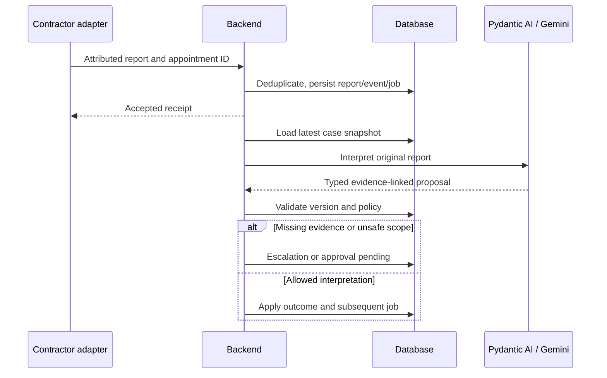
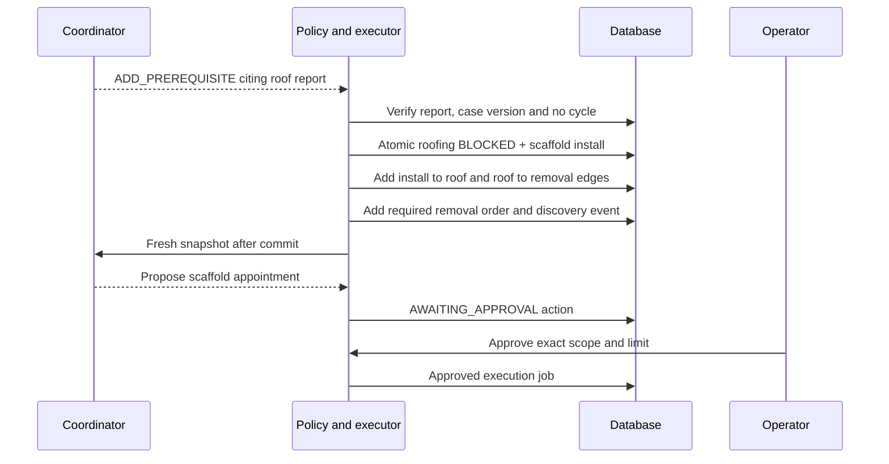
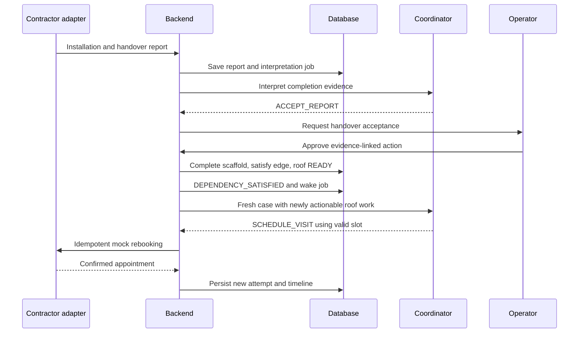

# 16 — HTTP API, webhooks and event sequences

Updated 24 October 2026. Calling, provider voice tools/webhooks and recording
routes are removed. Historical communication fields remain readable for storage
compatibility. This is a selected contract reference; current OpenAPI is the full
route inventory.

These are **RepairFlow application routes**, not vendor endpoints. JSON models are defined in 06/10. Prefix ordinary API routes with `/api/v1`. Generate OpenAPI and a TypeScript client once implemented.

## Shared conventions

Text intake optionally accepts `Idempotency-Key`. Demo replies require `input_id` and `expected_case_version` in the body; other commands use their documented version/idempotency fields. A duplicate key with identical payload returns the original result; conflicting reuse is HTTP 409. Version conflicts return 409 STALE_VERSION with current version. Invalid input is 422; forbidden scope 403; missing record 404; provider work accepted for asynchronous execution 202.

Errors have `{error: {code, message, retryable, correlation_id}}`. Do not leak provider secrets or full transcripts in errors. Lists return `{items, next_cursor}`; case detail returns `{snapshot, latest_event_seq}`.

## Operator and UI endpoints

| Method/path | Input | Result / behavior |
|---|---|---|
| GET `/healthz` | None | Liveness only, no secrets |
| GET `/api/v1/readiness` | Operator auth | DB/worker/integration configuration state; no costly provider calls |
| GET `/api/v1/cases` | cursor, limit | Compact case list |
| GET `/api/v1/cases/{id}` | optional known version | CaseSnapshot; ETag or unchanged response for polling |
| GET `/api/v1/cases/{id}/events` | after_seq, limit | Ordered event page |
| GET `/api/v1/cases/{id}/runs` | cursor, limit | OrchestrationRun and redacted ToolTrace records |
| POST `/api/v1/intakes` | IntakeSubmission | Case/communication binding; 201 new or 200 duplicate |
| POST `/api/v1/cases/{id}/observations` | ObservationSubmission | Accepted sourced facts; 202 |
| POST `/api/v1/cases/{id}/reports` | ReportSubmission | Persist report and enqueue interpretation; 202 |
| POST `/api/v1/actions/{id}/approval` | ApprovalDecision | Approval/rejection of exact action; 202 |
| POST `/api/v1/appointments/{id}/cancel` | CancellationRequest + version | Cancellation intent; 202; not immediate proof |
| POST `/api/v1/cases/{id}/resume` | version, reason, resolved_hold_evidence | Operator-reviewed hold release; 202 |
| POST `/api/v1/cases/{id}/reopen` | version, reason, evidence_refs | Authorized RESOLVED or reviewed late-evidence ESCALATED → ACTIVE; 202 |
| POST `/api/v1/cases/{id}/cancel` | version, reason | Guarded case cancellation; 202 |
| GET `/api/v1/communications/{id}` | None | Full transcript, outcome, recording status and provider ID |
| GET `/api/v1/research/{id}` | None | Logged query, timestamp, sources, candidates, provenance |

## Current simulated response contract

`POST /api/v1/cases` is text intake. `simulated` defaults to true. It accepts
property/tenant IDs, description, location, source_text, optional category/start time,
safety_answers and confirmed availability. SIMULATED provenance is carried through
to risk, issue evidence and availability; the original source text is retained.

`POST /api/v1/cases/{id}/demo-inputs` returns HTTP 202 and `{input_id, result}`.

| Field | Contract |
| --- | --- |
| input_id | Required UUID; reuse only for an identical retry |
| expected_case_version | Required current integer version |
| kind | TENANT_REPLY, AVAILABILITY, CONTRACTOR_REPORT, ATTENDANCE_OUTCOME, TENANT_CONFIRMATION or OPERATOR_UPDATE |
| text | Required nonblank text, at most 4,000 characters |
| appointment_id | Required only for report/attendance kinds; must belong to the case |
| response_to_communication_id | Optional pending request ID; same case and intended speaker required |
| safety_answers | Optional explicit structured answers for information replies |
| availability | Optional confirmed future windows for information replies; required for AVAILABILITY |
| confirms_resolved | Required boolean only for TENANT_CONFIRMATION |
| attendance_outcome | Required only for ATTENDANCE_OUTCOME: NO_ACCESS, NO_SHOW or AWAITING_REPORT |

An immediate SQLite write reservation makes the version check, idempotency and
writes atomic. Reusing an input ID with different content is 409; an identical
retry is NOOP. A stale version is 409. Invalid shape is 422. Wrong-case references
are rejected. Archived/terminal cases reject new evidence; reopen first. Escalated
cases can record evidence but cannot auto-resume.

Text becomes model-visible evidence. Reports go through normal report interpretation.
No-access/no-show entries become reports; they never claim completion. Missing-report
input moves scheduled work to AWAITING_REPORT. Confirmation is allowed only at
AWAITING_CONFIRMATION, and still needs an agent RESOLVE_CASE proposal plus closure
policy. RESOLVE_CASE must cite the latest affirmative confirmation event in this
case. A negative tenant response keeps the case open.

An explicitly linked response closes only that request. Unlinked contractor reports
close matching operator CONTRACTOR-purpose requests, leaving unrelated tenant
questions pending. Accepted evidence increments the case version once and enqueues
one deduplicated coordinator wake.

`GET /cases/{id}/runs` includes actual read-tool traces and additive `action_state`
and `action_error` fields from the exact corresponding action proposal. Model success
and execution success are separate facts. A FAILED action includes its recorded
error; a proposal with no matching ledger entry has null execution fields.

## Minimal demo authentication

The local prototype defaults operator authentication off. Enabling the backend Basic-auth setting protects operator APIs; this is not a production authentication design. No password in source, frontend bundles or query strings. Use the configured localhost CORS origins; do not treat this prototype as a production public API.

This is a synthetic single-operator demo boundary, not production multi-tenant authentication. Real residents require proper identity, roles, tenant isolation and audit controls before launch. Recording download routes have been removed.

## Contractor report sequence

## Dependency-discovered sequence

The graph is created by an interpreted report, not a pre-existing scaffold branch hard-coded into the initial case. The scaffold-removal safety obligation is a deterministic domain rule once scaffold work is introduced.

## Prerequisite completion and resumption

Automatic continuation follows the approval and observed completion; it does not mean the model certifies scaffold safety. Roof completion subsequently releases removal through the same edge mechanism.

## Versioning and acknowledgments

Keep `payload_version=1` on application events; do not overwrite historical payloads when models change. Operator edits and webhook observations increment the case version when they change operational state. Recording metadata/timeline-only events advance event sequence but need not invalidate an unrelated operational proposal. Poll responses include both version and latest_event_seq so evidence updates remain visible.

Demo visit evidence can describe a simulated appointment before its scheduled calendar date. The recorded submission time is actual UTC; no security, lease or application clock is advanced.

## 24 October demo evidence amendment

`POST /api/v1/cases/{id}/demo-inputs` supports `withdraw_availability: boolean`
(exclusive with replacement windows) and `resolved_concerns: string[]` (only
OPERATOR_UPDATE, exact existing selected concerns, nonblank explanation). Protected
tenant-dispute markers and safety risk are not cleared through concern selection.
Pending report requests require visit evidence; partial access replies do not
satisfy access requests. Ambiguous multiple contractor requests remain pending
unless an explicit request ID is supplied.
