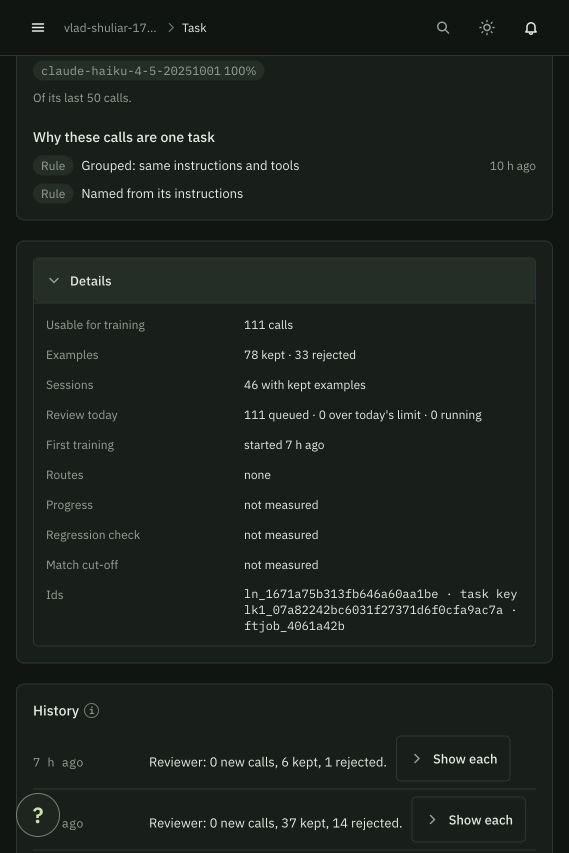
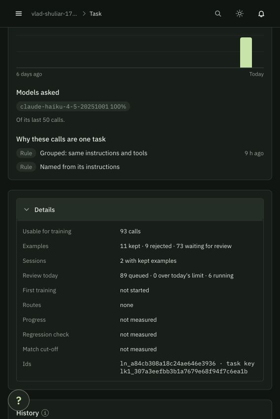
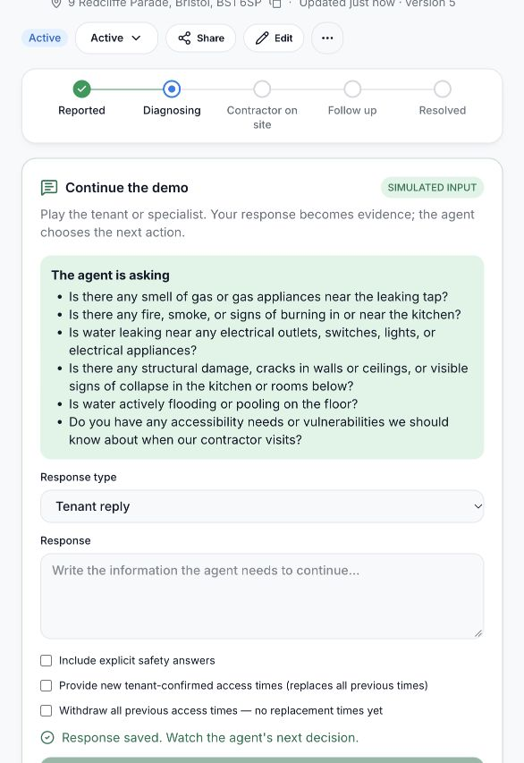

# Decision reliability audit — 24 October 2026

## Scope and stages

1. Reproduce four observed decision weaknesses with deterministic model responses.
2. Add bounded output correction without changing the static prompt or tool schema.
3. Audit evidence ingress, state transitions, execution, approvals and recovery.
4. Review response UI identity and full action visibility.
5. Independently review changes; run offline regression suites and browser checks.
6. Inspect Mubit separately and report training evidence without claiming unmeasured gains.

## Four observed weaknesses corrected

| Weakness | Correction |
|---|---|
| Incomplete safety questions | Require explicit coverage of every unanswered safety category before tenant questioning proceeds. |
| Repeated triage after work exists | Reject repeated non-hazard triage and ask the model to continue existing work. |
| Completion without report evidence | Require the exact report ID and matching provenance in completion references. |
| Scaffold/access equipment classified as tenant no-access | Reject the ambiguous classification and require clarification, supported prerequisite work, or escalation. |

Each has a two-call offline model test: invalid proposal, bounded correction, safe proposal. These are engineering guards, not evidence of trained weights. Category matching checks question coverage, not semantic truth; report references do not prove physical repair.

## Additional fixes

- Negative tenant confirmation creates follow-up repair work, preserves completed history and requires fresh approval.
- Reopening a resolved repair creates follow-up work; old affirmative confirmation cannot close it again.
- Reports must match the exact contractor, appointment, work order and latest attempt; processed reports cannot replay.
- Confirmation is accepted only after required work is complete.
- Pending actions recheck current case state, risk and approval; a booking invalidated during dispatch is compensated.
- Case cancellation retires pending work, appointments, requests and actions. Cancellation also works while awaiting confirmation.
- Rejected approvals produce a visible operator hold with explicit Resume.
- New access windows replace previous access; withdrawal is explicit. Conflicting outstanding visits require operator cancellation/rearrangement before Resume.
- Scheduling options exclude expired, wrong-person or unconfirmed availability and work/case states that cannot book.
- Safety facts require typed, explicitly confirmed answers.
- Partial availability and missing-report notices do not falsely satisfy pending requests.
- Ambiguous contractor requests are not bulk-closed by a report.
- Invalid request recipient/purpose pairs are rejected; newly required questions expand an existing request.
- Response drafts pin their request and appointment; polling cannot silently redirect them.
- Approval details expose the full proposed action and evidence.
- Operator concern resolution is explicit, selected, explained and audited; it cannot clear hazards or the tenant-dispute marker.

## Supported actions and recovery

| Situation | Agent action / operator control |
|---|---|
| Unknown facts or unclear report | Request information; contextual tenant/operator response |
| Known repair, no work yet | Apply triage |
| No suitable known specialist | Discover contractors; operator review |
| Ready work and confirmed access | Find options, schedule exact returned slot |
| Supporting work needed | Add prerequisite and enforce dependency order |
| Completed / failed / no-access visit | Accept evidenced report; retry work or escalate |
| Missing report | Attendance outcome; request specialist report or escalate |
| All required work done | Request tenant confirmation, then resolve using affirmative evidence |
| Still broken / recurrence | Follow-up work and fresh approval |
| Access withdrawn / operator rejects / unsafe or unsupported case | Visible hold, cancellation/rearrangement, explicit Resume |
| Outstanding documented concern | Operator selects concern and records how it was addressed |
| Waiting for external facts | Wait or request information; demo panel supplies simulated evidence |

The app does not promise every real-world case can be automated. Unsupported trades, ambiguous facts, hazards and unavailable providers must remain visible human handoffs. Physical work and communications are simulated. A failed model run can be revisited through a genuine operator update; there is no unbounded retry loop.

## Mubit observation — 13:27 BST

- Older task `ln_1671a75b313fb646a60aa1be`: 111 calls, 78 kept, 33 rejected. Training v1 started about seven hours earlier. UI identifies job `ftjob_4061a42b`, submitted on `Qwen/Qwen3-4B-Instruct-2507` from the base. Routes none; progress/regression not measured.
- Current task `ln_a84cb308a18c24ae646e3936`: 93 calls, 11 kept, 9 rejected, 73 waiting review. Six reviews running, zero over daily limit. First training not started; routes none.
- Eleven of 25 is an example threshold, **not 44% model accuracy or training completion**.
- No trained adapter quality/cost claim is justified yet. More traffic does not resolve the older pending training job. No paid collection was started during this audit.
- Next external dependency: Mubit must finish review/training and expose a tested adapter before a held-out teacher-versus-adapter comparison.

## Validation

**Final validation: 404 backend tests and 187 frontend tests passed; TypeScript and production build passed. Lint had zero errors and five existing warnings. Independent reviews approved the backend and frontend changes.** Original workspace validation: all 2,474 rows and 15 source files match the saved snapshot. All changes remain local.

## Final browser check and cost boundary

Case #103 was exercised through the actual browser against the restarted backend.
Withdrawal/replacement selections are mutually exclusive, and missing replacement
endpoints block submission. A simulated withdrawal was saved. The first live
model run exhausted its bounded correction and produced no accepted action; the
failure remains visible in history. A subsequent explicit operator clarification
recovered to REQUEST_INFORMATION with **all six safety categories**, and the
executor succeeded. The case remains ACTIVE, waiting for answers, with no booking.
This is an assisted recovery demonstration, not a claim of perfect autonomous accuracy.

Two live decision runs were used (four requests in the failed run and two in the
successful run). Durable reservations moved from 62 to 64 of the existing cap66.
No bulk training, holdout comparison, balance top-up or routing change was performed.
At the final console check, the project showed 293 requests, zero adapters serving,
and zero routed requests; task counters refresh asynchronously. The older task
remained Training with 78 examples, the current task Reviewing with 11 kept.

Further review fixes cover manual appointment cancellation/rescheduling, reapproval
when safety facts change, safe same-slot readmission only after conclusively failed
or compensated attempts, and superseded reports ordered by server receipt time.
UNKNOWN external outcomes remain blocked pending reconciliation. Fixed diagnostic
codes describe the last captured validation feedback without saving raw provider
errors or claiming it was necessarily the final failure cause.

