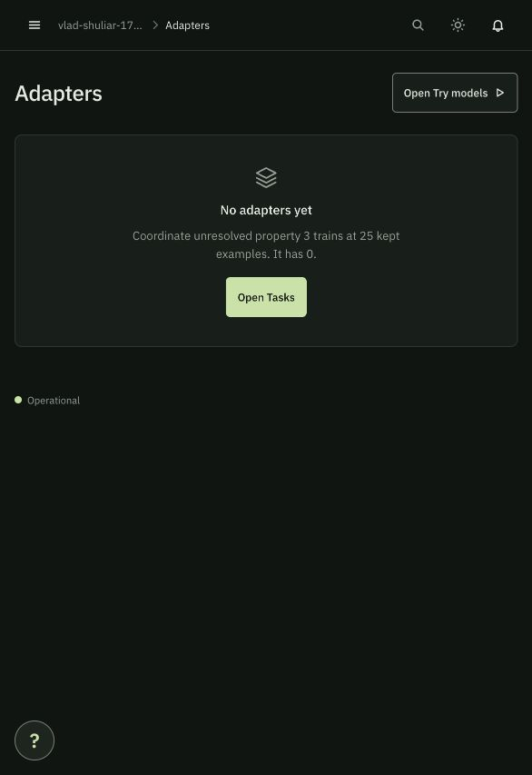
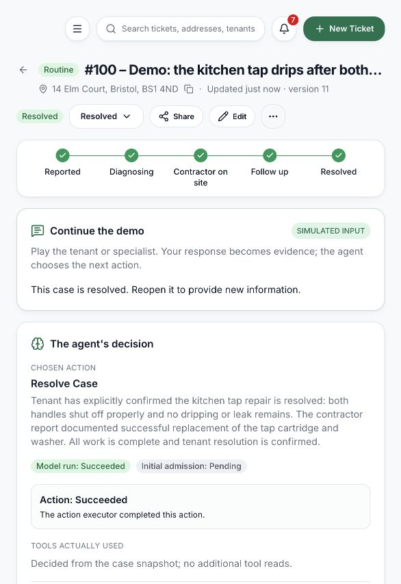
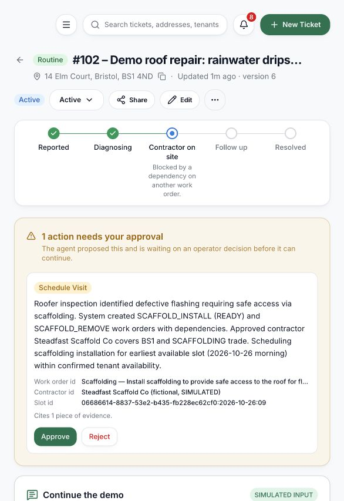
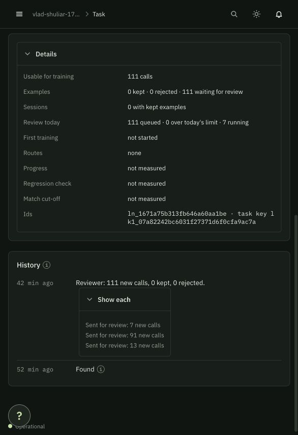
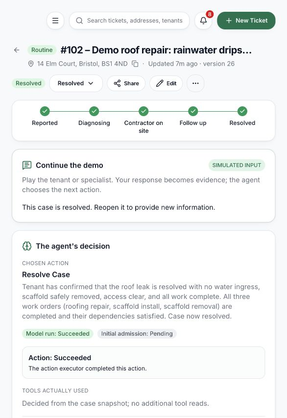
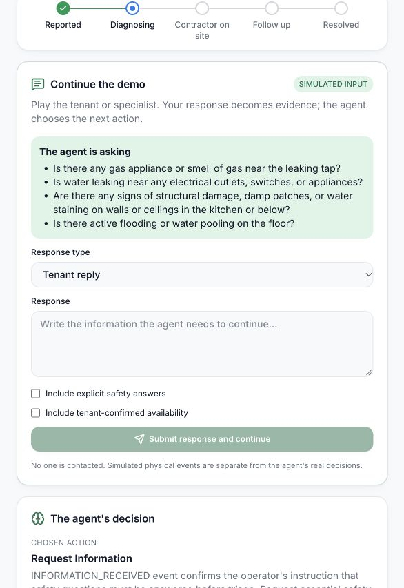

# Text demo verification — 24 October 2026

Status: implementation and representative browser journeys verified; Mubit training remains blocked by its review queue. This report distinguishes actual
Mubit-backed decisions, deterministic tests and simulated physical work.

## Environment and data

- Frontend: http://localhost:5174; API: http://127.0.0.1:8000.
- Browser scenarios use `backend/data/demo-workspace/repairflow.db`.
- Original workspace validation: all 2,474 rows identical to the saved snapshot;
  all 15 source files byte-identical. Demo SQLite integrity OK, no foreign-key errors.
- Simulated bookings/reports/responses never contact a tenant or contractor.

## Browser evidence

| Case | Scenario | Observed result |
|---|---|---|
| 100 | Kitchen tap, missing access information | Agent requested availability. Text reply saved explicit safety answers and access. |
| 100 | Scheduling recovery | Exact tool-returned slot selected for Harbourside, which covers BS1; action succeeded. |
| 100 | Full completion and recovery | After corrections, ACCEPT_REPORT → REQUEST_CONFIRMATION → explicit tenant yes → RESOLVE_CASE. Browser verified RESOLVED v11. Earlier failed decisions remain visible in history. |
| 101 | Gas smell reported at intake | Deterministic escalation, no paid model request, no booking. |
| 102 | Roof leak and scaffolding | Roof booking → scaffold prerequisite and approval → handover approval → roof repair → removal booking approval → missing report escalation → late report and operator Resume → report approval → tenant confirmation → RESOLVED v26. |

| 103 | Missing safety facts | Initial triage was held for approval. After the new missing-facts guard and a clarification, REQUEST_INFORMATION succeeded; no booking was made. Obsolete triage was rejected through the dialog; no paid wake was generated. |

Browser smoke views: Properties, Contractors, Tenants, Messages, Insights and Reports render populated
data. Case overview, agent timeline/history and contextual report form inspected.

## Defects discovered and corrected

- Safety UNKNOWN could be converted to NO by a model: deterministic evidence guard
  plus bounded model correction now prevents invented safety answers.
- Invented slot ID/wrong-area contractor: output must cite an actual returned option;
  executor rechecks service area and trade.
- UI confused successful model output with execution success: actual action ledger
  status and error are now shown separately.
- Case-version conditional polling hid communication/job changes: fresh detail reads.
- Excess context reached token ceiling: compact evidence and eligible contractor
  roster reduced case100 prompt characters by 73%; the 60,000-token ceiling remains.
- Final failed-run polling, processed-report rejection, confirmation evidence validation, research follow-up wake, and required-work closure checks were corrected and covered by regression tests.
- Nonhazardous triage now requests missing critical safety answers; unknown does not mean safe.
- Approval rejection uses an in-page reason dialog so it works in embedded browsers.

## Mubit evidence

Console checked 24 October, 04:14 BST: **no adapters**, **0 kept examples** on the
main task, **25 kept examples required**. Project overview at 04:12 showed 194
recorded calls and 0 adapters serving. All 5 visible tasks showed 0/25. Learnings
page earlier showed none. Main earlier
collection task: 111 usable calls, 111 waiting review, 0 kept, 0 rejected; first
training not started. The queue still showed 7 running and 0 over the daily limit;
its last reviewer history entry was 42 minutes old. No manual review/train action
was exposed on the inspected task page. This is recorded traffic, not completed learning/training.

The previous 48-case collection is documented separately in
[MUBIT_COLLECTION_RESULTS.md](MUBIT_COLLECTION_RESULTS.md). Prompt revisions and
new guards in this work are engineering improvements, not trained-adapter gains.
Held-out model comparison remains unavailable until a trained adapter exists.

## Budget

Durable run reservations cap live decisions at 30 across restarts and output folders.
Each run permits at most 10 model requests, 8 read-tool calls and 60,000 tokens;
token enforcement can overshoot by one response. Failed attempts consume a run.
This guard does not claim to read or enforce Mubit dollar balance. No new bulk
collection has been started during these browser checks.

Recorded local metrics across 26 reservations: 700,063 input and 18,792 output tokens reported; median recorded run latency 7.36 seconds. Failed calls may omit token usage, so totals are a lower bound, not billed usage. See [machine-readable summary](demo-evidence/verification-summary.json).

## Resolved normal repair

## Approval boundary

Scaffold scheduling paused for operator approval; the booking was only performed
after the browser approval action. Scaffold handover acceptance also required
a separate approval.

Mubit sign-in expired during inspection. With explicit user authorization, the
connected Gmail account and its latest Mubit verification email restored the
session. No login code is stored in repository artifacts.

## Final verification and limits

- Backend: **304 tests passed in 21.25 seconds**, including the final unknown-safety guard. Independent review approved it (11 focused tests). Earlier budget/workflow review passed 48 focused tests.
- Frontend: **158 tests passed**, including the final rejection-dialog regressions. TypeScript and production build passed; lint had zero errors and five existing warnings.
- Demo SQLite integrity: OK; zero foreign-key violations. Original 2,474 content rows and 15 files match the saved snapshot.
- Browser journeys verify representative paths, not every possible model response. No-access, no-show, negative confirmation, duplicate/stale/cross-case inputs and failure/budget branches also have offline coverage; see [coverage matrix](DEMO_BACKEND_COVERAGE.md).
- Earlier failed proposals remain in case history as real evidence of issues found and corrected. The successful journeys are recovery-inclusive, not flawless first attempts.
- 26 of 30 durable live-run reservations used. Per-run ceilings are not an exact dollar cap; the console did not expose a usable balance. No further bulk collection or paid comparison was run.
- No trained adapter exists to benchmark. Mubit review/training must complete before making learned-quality or cost-savings claims.

