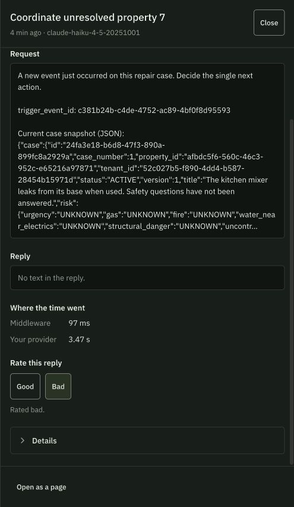
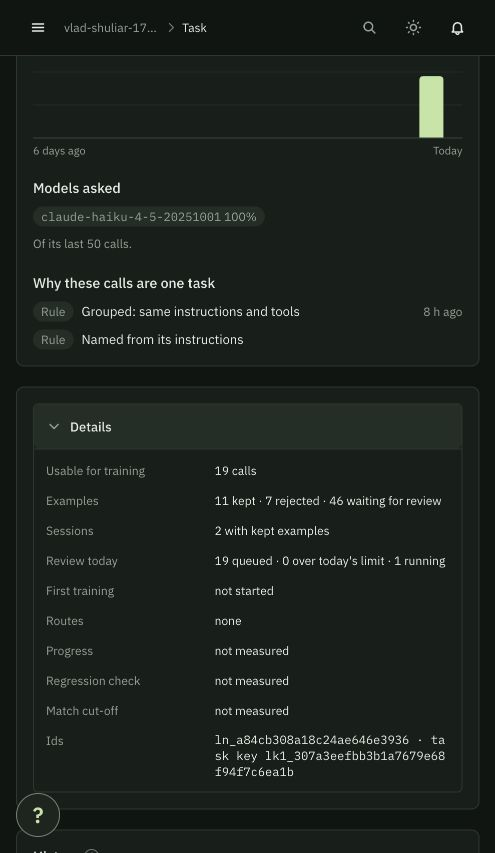

# Targeted lifecycle training expansion — 24 October 2026

## Objective

Collect varied synthetic repair decisions using the current coordinator, then
measure a trained adapter against the provider on unseen cases when it is available.
This cannot establish coverage of every possible situation or general equivalence
to a large model. Collection correctness, accepted examples, training completion,
and held-out performance are separate measurements.

## Starting evidence

Console around 12:36 London time: main legacy task has 78 kept/33 rejected from
111 calls and Training v 1 started about six hours earlier. No adapter is available;
progress and regression results are not measured. Eight active lessons exist.
Current project has seven tasks; two recent tasks have 24/25 and 11/25 kept examples.
Billing displays $25.00; this is the displayed Mubit balance, not a statement about
separately billed Anthropic provider usage.

## Execution plan

1. Keep prompt version 7, model and tools stable; do not revert safety improvements
   merely to increase an old task's example count.
2. Add new lifecycle scenarios with expected actions and evidence checks. Preserve
   the existing v 2 holdouts. Reserve additional whole cases as unseen evaluation.
3. Validate all synthetic states locally, review the code, and use a separate DB.
4. Send six training scenarios, inspect correctness, usage and console grouping.
5. If the pilot is sound, send remaining distinct training cases, up to 36 total.
   Stop on repeated errors or failed scores. Never repeat calls to inflate counts.
6. Recheck accepted examples, training/adapter status and balance. Run a comparison
   only if a usable adapter exists. Keep evaluation recording off.

## Limits

The shared durable ledger starts at 26 reservations. Collection may extend it to 62
for this authorized batch, with 40,000 tokens per run and the existing bounded tool/
request limits. These are run/token controls, not an exact dollar cap; token usage
can exceed a limit by one response. No billing settings, payment method, model
provider, or task-training policy is changed. No external communications occur.

## Honest hackathon evidence

Report the number and types of new cases, local pass rate, request/token usage,
kept examples and training status. Record any failed cases, not only successes.
A trained model can be called comparable only after the same unseen cases have
been evaluated on both models, with action validity, required work, safety,
reference correctness, latency and cost measured separately.

Official process: https://docs.mubit.ai/guides/first-adapter

## Completed collection

Added 36 lifecycle training cases, 18 unseen lifecycle cases and 6 evaluation-only
safety probes. The 64-case legacy dataset and its 16 holdouts are preserved.
Training spans nine states: missing safety, missing availability, ready to schedule,
completed report, no-access report, failed repair report, requesting confirmation,
positive tenant confirmation and scaffolding prerequisite. This is coverage of
selected workflow states, not exhaustive coverage of the world.

All 36 training cases were sent once through prompt 7/Anthropic Haiku using Mubit:
77 model requests, 573,206 input tokens and 20,192 output tokens. Sum of coordinator
run durations 224.247 seconds; median 5.366 seconds. These are observed token/latency
metrics, not dollar costs.

### Quality and corrections

After reviewed offline rescoring, 28 of 35 scorable proposals passed (80%); 7 failed.
One scheduling proposal was lost when the initial evaluator raised an attribute
error; it cannot be counted as either correct or incorrect. The runner now saves
proposals before scoring, distinguishes evaluator errors and stops immediately
on those errors. Initial completion-reference scoring was also corrected to
recognize a report's actual recorded source reference.

The 7 genuine failures comprise 4 incomplete safety questionnaires, 1 repeated
triage despite an existing work order, 1 missing completion-evidence reference,
and 1 missed scaffold prerequisite classified as no access. These remain failures;
the scorer was not loosened to hide them. Four representative incorrect replies
were rated Bad in Mubit with explanatory comments. A saved rating is feedback,
not proof that a corrected target entered model weights.

This 80% is a guarded teacher-proposal score on training inputs. It is NOT adapter
accuracy, an unseen benchmark, policy/execution success or end-to-end completion.
The teacher is the configured Haiku provider, not an unspecified larger frontier
model. All 40 heldout cases (16 legacy+18 lifecycle+6 safety) remain unuploaded.

### Console evidence, approximately 12:52 London time

The 77 new calls are grouped under the existing current-prompt task
[Coordinate unresolved property 7](https://app.mubit.ai/console/projects/ws-f7685debbc87c0ad/workloads/ln_a84cb308a18c24ae646e3936),
whose traffic increased from 16 to 93 calls. Status is Reviewing examples, 11 kept;
details showed 7 rejected, 46 awaiting review and 1 reviewer running. The asynchronous
review panel still counted 19 usable/queued calls while traffic showed 93; these
are different evolving counters and must not be added together. This task's first
training has not started. The older main task remains Training v1. Final Adapters check at 12:55 London time showed No adapters yet; no usable adapter
has been confirmed, so a small-model/provider comparison cannot yet be made.

Billing displayed $25 before collection and $50 afterward. No funds, payment method
or billing settings were changed by this work. Those balances do not establish
provider charges or collection savings.

### Verification and next step

- Independent Python review completed; 16 focused offline tests passed.
- Full backend suite: 307 passed in 20.46 seconds; whitespace check clean.
- Original 2,474 database rows and 15 files match the saved snapshot.
- Collection used isolated databases; no operational actions or outreach occurred.
- Shared run ledger now 62; configured cap 66 leaves 4 demo runs. Backend restarted
  against the existing demo database; frontend remains running.
- Wait for Mubit review/training before another collection. If its result is below
  target, use the reported weak cases for a targeted batch. If it passes, compare
  the adapter and provider on the reserved unseen cases with recording disabled.

[Machine-readable metrics](demo-evidence/training-expansion-summary.json)

